<div align="center">

# Nexora SafarPro

**Travel agency management for Pakistan — bookings, air tickets, visas, Umrah groups, tours and double-entry accounts, running fully offline on a Windows PC.**

[](https://nexoraservices90.pythonanywhere.com)
&nbsp;


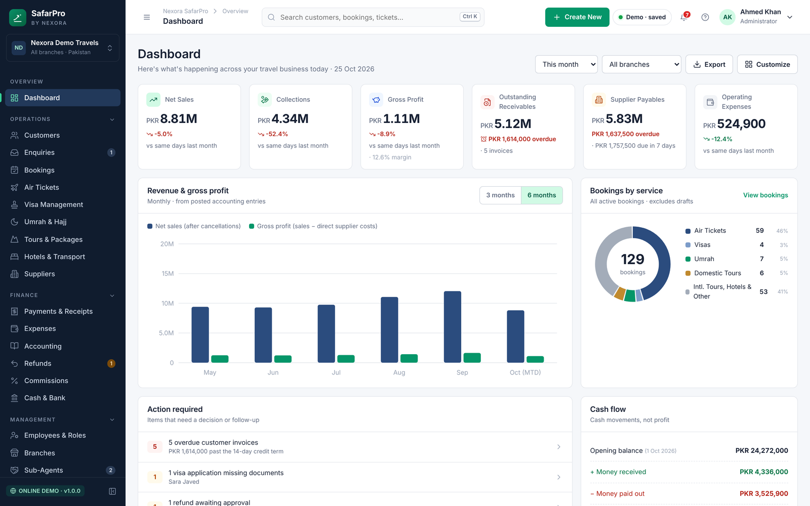

</div>

## The problem

Small travel agencies run on WhatsApp, paper registers and Excel. Nobody can say at a glance who still owes money,
which supplier is due, how many Umrah pilgrims are missing passports, or what the agency actually earned this month.
Most agencies also don't have reliable internet or the budget for a cloud subscription.

## The solution

SafarPro is a complete back-office system that installs on the agency's own Windows PC and works with **no internet**.
Every sale, payment, refund and expense is posted as a **balanced double-entry journal entry**, so the dashboard,
receivables, supplier payables and Profit & Loss are always calculated from the same books — never typed in by hand.

> **Try it:** the [live demo](https://nexoraservices90.pythonanywhere.com) signs you in with one click as an Administrator,
> Branch Manager, Accountant, Visa Officer or Receptionist. All data is fictional and resets every 24 hours.

## Features

| Area | What it does |
|---|---|
| **Customers & CRM** | Customer profiles with masked CNIC/passport, enquiries pipeline, quotations, follow-ups, communication log |
| **Bookings** | Air tickets, visas, Umrah, tours, hotels, transport — one booking engine with server-calculated balance and payment status |
| **Umrah & Hajj** | Packages, groups, pilgrim manifest (passport, visa, room, payment), manifest export |
| **Tours** | Packages with itineraries, departures with seat capacity, cancellation policy |
| **Visas** | Application workflow from *Documents Pending* to *Approved*, document checklist and reminders |
| **Payments** | Partial payments, printable receipts with amount in words, reversals instead of edits, double-click safe |
| **Refunds** | Request → review → approval → completion, cancellation fees, supplier credits |
| **Accounting** | Chart of accounts, journal, trial balance, P&L, balance sheet, cash book, bank reconciliation, period closing |
| **Suppliers & agents** | Supplier ledgers with due dates, sub-agents with credit limits and requests |
| **Staff & security** | 9 roles enforced on the server for every action, login lockout, CSRF protection, full audit log |
| **Data safety** | Verified one-click backups (SQLite snapshot + documents + SHA-256 manifest), restore with automatic safety backup |
| **Branches** | Multiple branches with their own cash accounts and branch reports |

## Screenshots

| | |
|---|---|
| 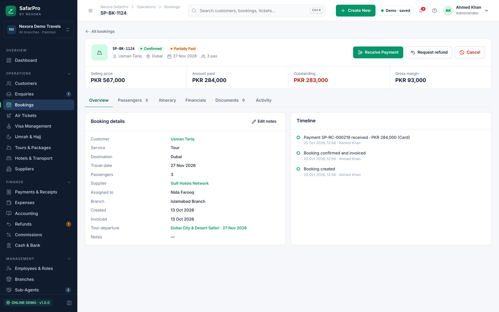<br>**Booking detail** — balance, margin and timeline | 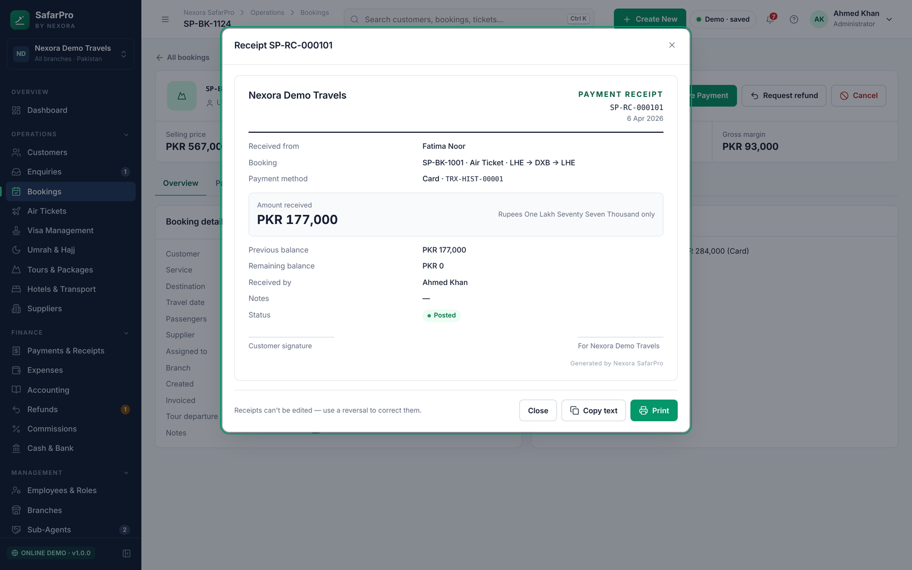<br>**Payment receipt** — amount in words, immutable |
| 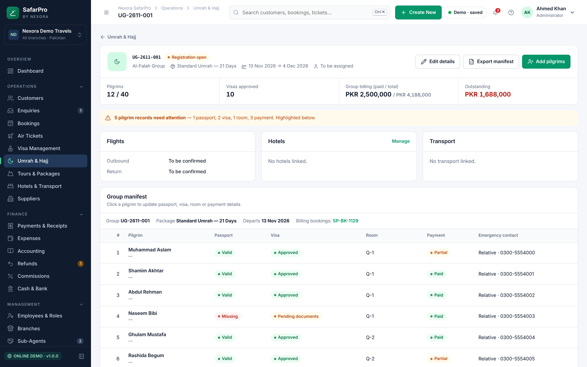<br>**Umrah group manifest** — passports, visas, rooms | 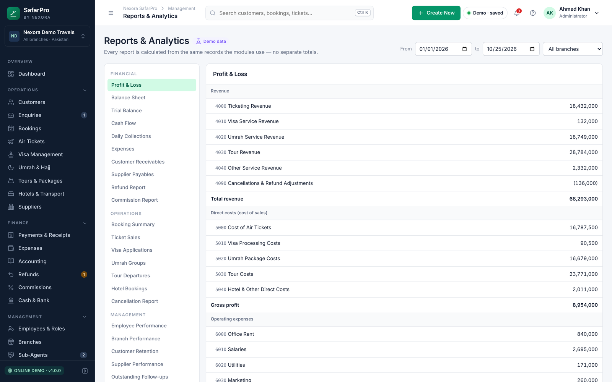<br>**Profit & Loss** — from posted journal lines |
| 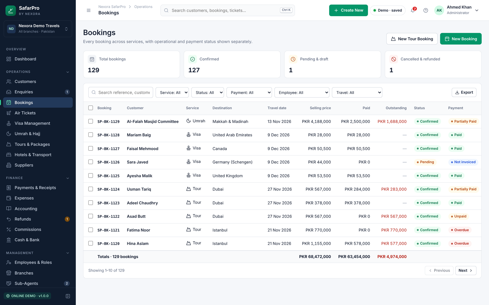<br>**Bookings** — operational and payment status side by side | 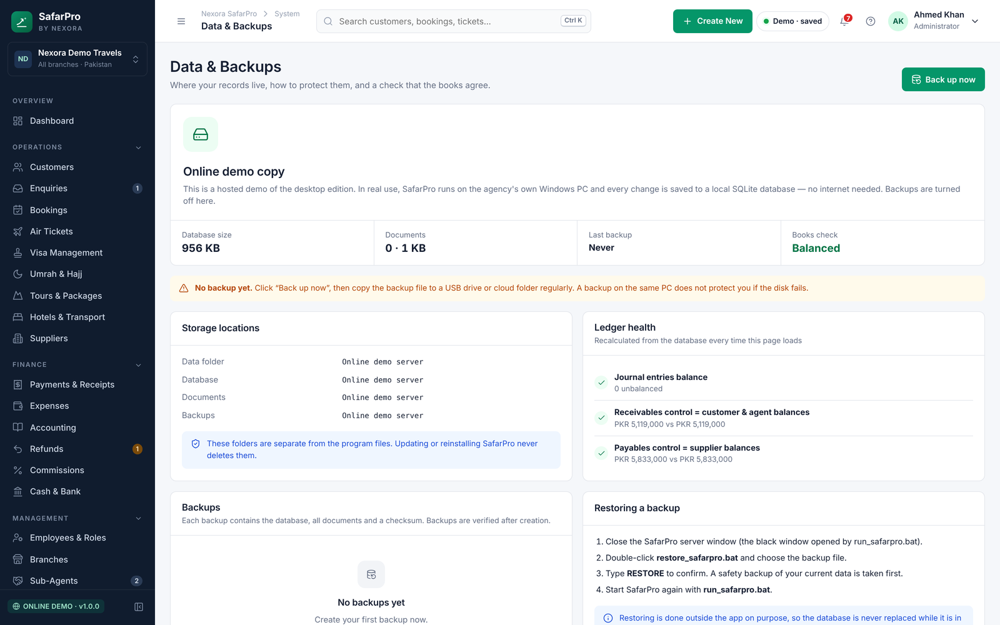<br>**Data & Backups** — live ledger health check |
| 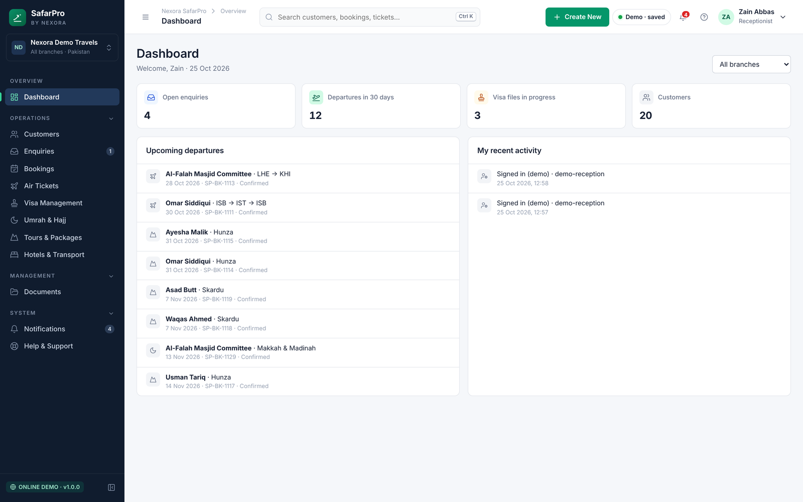<br>**Receptionist login** — sees only front-desk work | 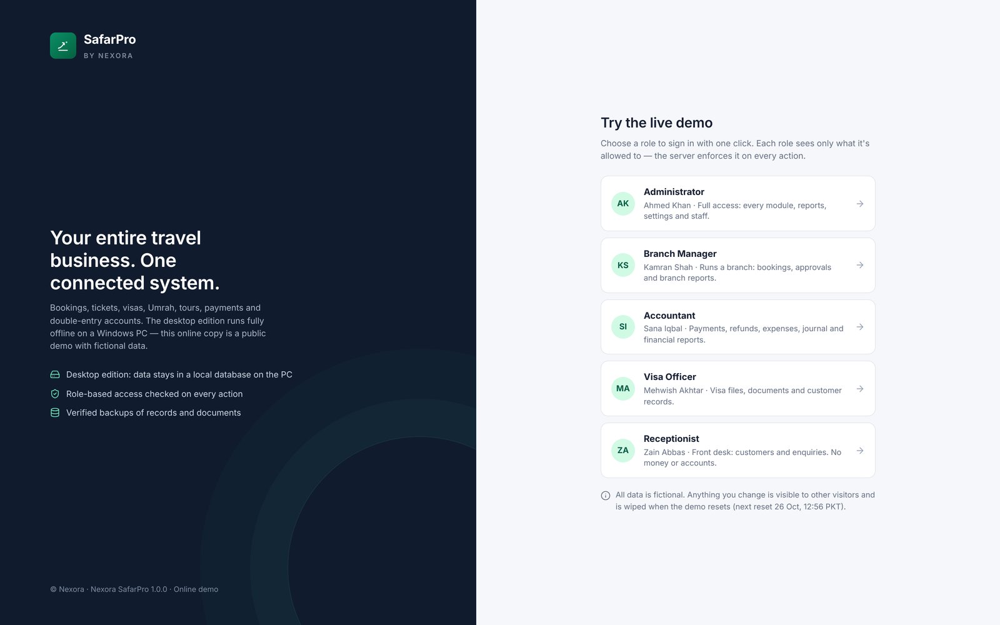<br>**Sign in** |

<p align="center">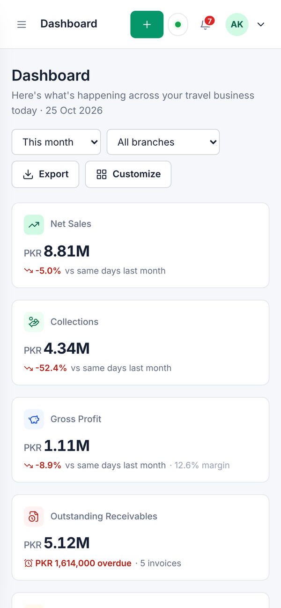<br><em>Works on a phone browser too</em></p>

## How it works

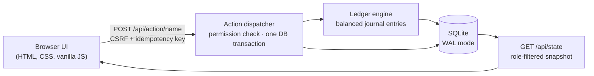

- **One action endpoint.** Every change goes through a single dispatcher that checks the user's role on the server, runs inside one
  database transaction, and refuses duplicate submissions (each form carries an idempotency key — double-clicking *Pay* records one payment).
- **Money is never edited.** Posted entries are immutable; mistakes are corrected with reversal entries, keeping a full history.
  Balances and payment status are always computed from the ledger.
- **Ledger health check.** Receivables and payables control accounts are reconciled against the booking and supplier sub-ledgers on every load.
- **Offline by design.** Fonts and icons are bundled; the app makes no external requests. Data lives in `%LOCALAPPDATA%\Nexora\SafarPro`,
  separate from the program, and is never reset by updates (database changes are backed up before every migration).

## Tech stack

**Backend:** Python 3, Django 5.1, SQLite (WAL), waitress · **Frontend:** HTML, CSS, vanilla JavaScript (no build step), Inter font, Lucide icons ·
**Tooling:** Django test runner · **Deployment:** Windows batch installers; public demo on PythonAnywhere

## Project structure

```
safarpro/     settings, URLs, WSGI
core/         organization, branches, numbering, audit log, backup & restore, first-run setup
accounts/     employees, roles & permissions, sign-in
crm/          customers, enquiries, quotations, documents
operations/   bookings, tickets, visas, Umrah, tours, hotels, transport, suppliers, agents
finance/      chart of accounts, ledger engine, payments, refunds, expenses, commissions
web/          JSON API, templates, static assets, demo mode, tests
deploy/       PythonAnywhere demo configuration
```

## Run it

**Windows (the real product):** install Python 3.10+, double-click `setup_windows.bat`, then `run_safarpro.bat`.
The first start asks you to create your agency and administrator. Full guide: [docs/USER_GUIDE.md](docs/USER_GUIDE.md).

**Developers:**

```bash
python -m venv .venv && . .venv/bin/activate      # Windows: .venv\Scripts\activate
pip install -r requirements.txt
python manage.py migrate
python manage.py test web                          # 39 tests
python launch.py                                   # http://127.0.0.1:8765
```

## Tests

39 automated tests cover the double-entry postings, cancellations and refunds, period locking, payment status,
server-side role checks, CSRF, login lockout, document upload validation, backup creation and corrupted-backup rejection,
duplicate-submission protection and the public demo mode.

## Status

Version 1.0 — single-PC edition. Multi-PC sync and a mobile app are not included yet; the app says so instead of pretending.

## Author

**Talha Zubair** — Nexora Software & Web Solutions
Business software for travel agencies, schools and small businesses in Pakistan.
📧 nexoraservices90@gmail.com · 🐙 [@talhazubair2401](https://github.com/talhazubair2401)

<sub>© 2026 Talha Zubair. All rights reserved — see [LICENSE](LICENSE).</sub>
